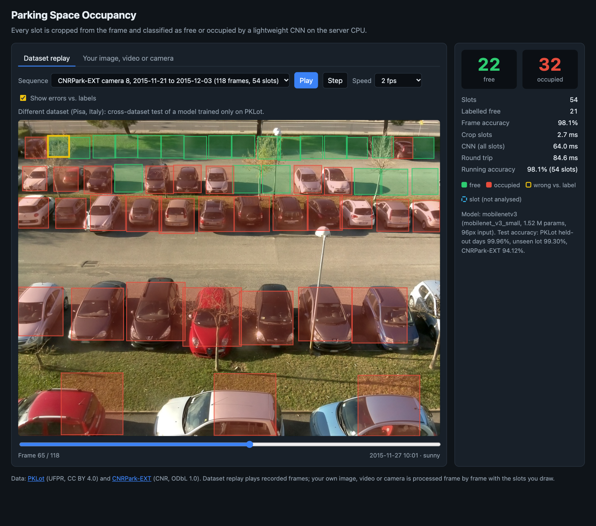
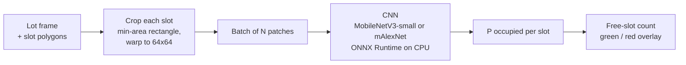
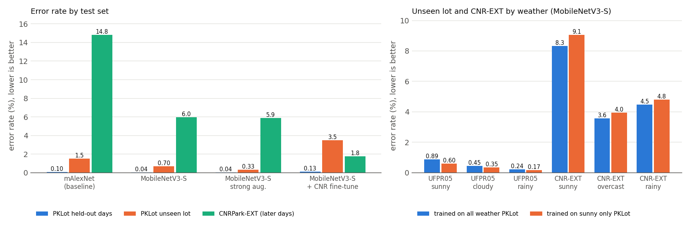

# Parking Space Occupancy Detection

Per-slot parking occupancy (free / occupied) from a fixed lot camera, with lightweight CNNs, and a measurement of how much accuracy is lost when the model leaves the parking lot it was trained on.

**Result:** MobileNetV3-small (1.5 M parameters) reaches **99.96%** accuracy on held-out days of the two PKLot lots it was trained on, **99.30%** on a third lot it never saw (UFPR05) and **94.12%** on a different dataset recorded in another country (CNRPark-EXT, Italy). The error rate grows from 0.04% to 0.70% to 5.9%: changing the site costs far more than changing the weather. Fine-tuning on 3 labelled days of the new site brings the CNRPark-EXT error on the remaining days down from 5.98% to 1.77%. A frame with 100 slots takes about 60 ms on a laptop CPU (Apple M1, ONNX Runtime).



*The web demo replaying CNRPark-EXT camera 8 (27 Nov 2015, 10:01, sunny) with the model trained only on PKLot. It predicts 22 free and 32 occupied slots; with **Show errors vs. labels** on, the one slot where the prediction disagrees with the dataset label (predicted free, labelled occupied) is outlined in yellow. The timings in the panel are for this single request on the M1 CPU.*

---

## Features

- **Per-slot classification:** every annotated slot polygon is cut out of the frame, warped to a 64×64 patch and classified as free or occupied.
- **Two lightweight models:** MobileNetV3-small (1.52 M parameters, ImageNet-pretrained) and mAlexNet (55 k parameters, trained from scratch; Amato et al., 2017).
- **Domain-shift study:** the model is trained on two PKLot lots and tested on held-out days, on a third lot it never saw, across weather, and on a different dataset (CNRPark-EXT, Italy). Splits are made by whole days and lots, never by random patches.
- **Two ways to reduce the gap, measured:** stronger augmentation (no target data) and brief fine-tuning on 3 days of the target site.
- **CPU deployment:** models are exported to ONNX and run in ONNX Runtime; latency is reported per frame, not per patch.
- **Web demo:** a FastAPI app replays test frames from the datasets with slot polygons drawn green or red, a live free-slot count, per-frame timing and (optionally) the errors against the labels.
- **Your own lot:** load an image, a video file or your webcam in the same page. For lots seen from above, the slots are found automatically from the painted stall lines and the result appears right away; otherwise draw the slots with the mouse (4 clicks each) or load them from JSON. Video and camera run live, frame by frame.
- **Reproducible:** day-level splits in [`results/splits.json`](results/splits.json), seeded training, saved configs, metrics and plots in [`results/`](results/), and a test that checks every number in this README against the metrics files.

## Architecture



| Stage | Details |
|---|---|
| Slot crop | The slot polygon's minimum-area rectangle is rotated by the smallest angle that makes it axis-aligned (so the patch keeps the image's "up") and perspective-warped to 64×64. For an axis-aligned box this equals crop-and-resize, which is how the CNR-EXT patches were made. The CNR-EXT test set uses the dataset's own patches; the demo cuts CNR-EXT frames with this function from the per-camera boxes. |
| Classifier | MobileNetV3-small: torchvision ImageNet weights, input upsampled to 96×96 inside the model, 2-way head. mAlexNet: 3 conv + 2 FC layers, 224×224 input, from scratch. Resizing and normalisation live in the model, so both take the same 64×64 patches. |
| Inference | One batched forward pass per frame. The exported ONNX graph includes the resize and normalisation; ONNX Runtime and PyTorch agree to within 1.3e-5 in P(occupied) (`onnx_max_abs_diff` in each `metrics.json`). |
| Slot finding (own images) | [`parking/autoslots.py`](parking/autoslots.py), classical computer vision, no training: thin bright paint is isolated with a morphological top-hat (keeping only thin, elongated, white or yellow components that are brighter than the ground on both sides), line segments come from the probabilistic Hough transform, segments along the dominant direction are merged into stall separators and cut where a perpendicular centre line crosses them, separators with the same extent form a bay, double (hairpin) lines are merged, and every gap of 1 to 3 median stall widths becomes 1 to 3 slots, plus one slot past each end of a bay unless it lands on plants. About 60 to 160 ms per image on the M1 CPU. |
| Web app | FastAPI backend, plain HTML/CSS/JS frontend with no build step. The browser asks for one frame at a time and draws the polygons on a canvas. For your own image, video or webcam, the browser sends the frame as JPEG (with the slot polygons if you drew any) and draws the answer on the frame that was analysed. |

## Datasets

| Dataset | Source | License | Content |
|---|---|---|---|
| [PKLot](https://web.inf.ufpr.br/vri/databases/parking-lot-database/) (Almeida et al., 2015) | UFPR, Curitiba, Brazil | CC BY 4.0 | 12,417 frames (1280×720) from 3 lots (PUCPR, UFPR04, UFPR05), sunny / cloudy / rainy, one XML with every slot polygon and label per frame |
| [CNRPark-EXT](http://cnrpark.it/) (Amato et al., 2017) | CNR, Pisa, Italy | ODbL 1.0 | 144,965 labelled 150×150 slot patches from 9 cameras over 23 days (Nov 2015 to Feb 2016), sunny / overcast / rainy; full frames (1000×750) and per-camera slot boxes |

`scripts/download_data.sh` downloads both from the official links (PKLot from UFPR, CNRPark-EXT from the release assets the CNRPark site links to) and extracts them into `data/`, which is not tracked by git.

### Splits

Frames of one camera are taken every 5 minutes (PKLot) or 30 minutes (CNR-EXT) and consecutive frames are nearly identical, so a random patch-level split would leak almost the same image into the test set. Every split is therefore made by **whole days** or **whole lots**:

| Set | Lot / cameras | Days | Frames | Slot patches | Occupied | Used for |
|---|---|---:|---:|---:|---:|---|
| `pklot_train` | PKLot PUCPR + UFPR04 | 22 + 18 | 2,551 (every 2nd) | 170,614 | 48.1% | training |
| `pklot_val` | PKLot PUCPR + UFPR04 | 5 + 5 | 1,126 | 59,101 | 43.6% | model selection |
| `pklot_test` | PKLot PUCPR + UFPR04 | 9 + 7 | 2,054 | 128,872 | 37.8% | **in-domain test** (same cameras, unseen days) |
| `pklot_unseen` | PKLot UFPR05 | 33 | 4,152 | 165,785 | 58.8% | **unseen lot** (new camera, new lot, same city) |
| `cnr_ext` | CNRPark-EXT, 9 cameras | 23 | 4,081 | 144,965 | 54.7% | **cross-dataset** (new country, new cameras) |
| `cnr_ext` first 3 days | CNRPark-EXT | 3 | | 19,233 | 71.2% | fine-tuning experiment only |
| `cnr_ext` later days | CNRPark-EXT | 20 | | 125,732 | 52.2% | test set for the fine-tuning comparison |

PKLot days are assigned per lot, stratified by each day's majority weather (seeded, see `parking/splits.py`); the exact day lists are in [`results/splits.json`](results/splits.json). Training days keep every second frame; all other sets keep every frame. Model selection uses only `pklot_val`.

## Training

| Setting | Value |
|---|---|
| Optimiser | AdamW, weight decay 0.01, batch size 256 |
| Schedule | 12 epochs × 120,000 random patches (the sunny-only run: its whole 80,452-patch set per epoch), linear warm-up (0.5 epoch) then cosine decay to 0; peak lr 1e-3 (MobileNetV3) / 3e-3 (mAlexNet) |
| Loss | Cross-entropy, label smoothing 0.05, inverse-frequency class weights (training set is 48% occupied, so the weights are 0.96 / 1.04) |
| Standard augmentation | flips, rotation ±5°, scale 0.9 to 1.05, shift ±6%, brightness / contrast / saturation ±20% |
| Strong augmentation | any 90° orientation + rotation ±15°, scale 0.75 to 1.15 with aspect change, shift ±12%, colour jitter ±40%, per-channel gain, 20% greyscale, random shadows, blur, noise and occluding blocks |
| Model selection | best validation macro-F1 on `pklot_val` (ties: lower validation loss) |
| Hardware | Apple M1 (8 GB) via PyTorch MPS; augmentation runs batched on the GPU. About 37 min per MobileNetV3 run, 20 min for mAlexNet |

The exact configuration of each run is saved in `results/<run>/config.json` and its per-epoch history in `history.json`.

## Results

All numbers come from the checkpoint with the best validation macro-F1 and were measured once on each test set. Cells are **accuracy / macro-F1** over slots.

### Main results

| Model | Params | PKLot held-out days | PKLot unseen lot (UFPR05) | CNRPark-EXT (cross-dataset) | CPU time / frame (100 slots) |
|---|---:|---:|---:|---:|---:|
| mAlexNet (from scratch) | 0.06 M | 99.90% / 0.9989 | 98.49% / 0.9844 | 86.02% / 0.8600 | 63 ms |
| **MobileNetV3-small (ImageNet)** | 1.52 M | 99.96% / 0.9996 | 99.30% / 0.9928 | 94.12% / 0.9412 | 60 ms |



- **In-domain is saturated.** On held-out days of the training cameras both models make fewer than 1 error in 1,000 slots, so this split says little about how well a model generalises.
- **A new lot in the same city costs little, a new dataset costs a lot.** MobileNetV3's error rate goes from 0.04% (in-domain) to 0.70% (UFPR05) to 5.88% (CNRPark-EXT). mAlexNet, trained from scratch, degrades much more: 0.10% → 1.51% → 13.98%. The comparison mixes architecture and ImageNet pretraining, so it does not say which of the two matters more.
- **The cross-dataset errors are one-sided.** On CNRPark-EXT, 8,154 occupied slots are predicted empty and only 363 empty slots are predicted occupied (occupied recall 89.7%, empty recall 99.4%). Many CNR slots are partly hidden by trees, lamp posts and neighbouring cars (the dataset was built to include such occlusions), and a car that is only partly visible is likely to be called empty. On UFPR05 the errors go the other way (1,004 false "occupied" vs 158 false "empty").
- **Some cameras are much harder than others.** CNRPark-EXT accuracy of MobileNetV3 by camera:

| Camera | 1 | 2 | 3 | 4 | 5 | 6 | 7 | 8 | 9 |
|---|---:|---:|---:|---:|---:|---:|---:|---:|---:|
| 85.81% | 93.65% | 91.51% | 96.11% | 96.02% | 95.71% | 94.23% | 96.40% | 93.81% |

Confusion matrices for every test set: [`results/mobilenetv3/confusion_matrices.png`](results/mobilenetv3/confusion_matrices.png), [`results/malexnet/confusion_matrices.png`](results/malexnet/confusion_matrices.png).

### Weather

Accuracy by weather for the main model and for the same model trained (and selected) on sunny frames only:

| Training data | PKLot test sunny | cloudy | rainy | UFPR05 sunny | cloudy | rainy | CNR-EXT sunny | overcast | rainy |
|---|---:|---:|---:|---:|---:|---:|---:|---:|---:|
| all weather (sunny, cloudy, rainy) | 99.96% | 100.00% | 99.91% | 99.11% | 99.55% | 99.76% | 91.68% | 96.42% | 95.53% |
| sunny frames only | 99.96% | 100.00% | 99.88% | 99.40% | 99.65% | 99.83% | 90.95% | 96.04% | 95.18% |

- **Weather is a small factor next to the site.** Removing all cloudy and rainy frames from training and model selection barely changes the result: on the unseen lot the sunny-only model is even slightly better in every weather, and on CNRPark-EXT it is 0.3 to 0.7 points worse. With one seed per run, differences of this size should not be over-read.
- **Sunny is the hardest condition on both new sites,** for both models (UFPR05 99.11%, CNRPark-EXT 91.68% for the main model), probably because of hard shadows across the slots. Rain is not the problem.

### Reducing the gap

Two cheap fixes. Strong augmentation retrains the main model's recipe with the strong preset; fine-tuning starts from the main model and uses the first 3 CNRPark-EXT days (19,233 labelled patches; 2 epochs at lr 3e-4, about 1 minute, no model selection), so every model is compared on the **20 later days** it never saw:

| Model | PKLot held-out days | PKLot unseen lot | CNR-EXT later days | CNR-EXT sunny | overcast | rainy |
|---|---:|---:|---:|---:|---:|---:|
| MobileNetV3-small, standard augmentation | 99.96% / 0.9996 | 99.30% / 0.9928 | 94.02% / 0.9401 | 91.45% | 96.80% | 95.53% |
| + strong augmentation (PKLot only) | 99.96% / 0.9995 | 99.67% / 0.9966 | 94.10% / 0.9410 | 92.45% | 96.32% | 94.72% |
| + fine-tuning on the first 3 CNR-EXT days | 99.87% / 0.9986 | 96.51% / 0.9636 | 98.23% / 0.9823 | 97.92% | 99.54% | 97.59% |

- **Strong augmentation** (no target data) halves the error on the unseen PKLot lot (0.70% → 0.33%) but does **not** help on CNRPark-EXT (5.98% → 5.90%). The jitter seems to cover the variation between PKLot cameras but not the different viewpoints and occlusions of the CNR site.
- **Fine-tuning on 3 days of the new site** cuts the CNRPark-EXT error by more than two thirds (5.98% → 1.77%), including rainy days that are not among the 3 fine-tuning days. The price is forgetting: on UFPR05 the error rises from 0.70% to 3.49% (5,469 empty slots now predicted occupied). A fine-tuned model is a per-site model; keeping old-site accuracy would need mixing source data into the fine-tuning (not tried here).

### Speed

Median time to crop and classify every slot of one real frame (30 runs, 4 CPU threads, Apple M1). Numbers in brackets are the same model in PyTorch eager mode:

| Model | PUCPR, 100 slots | UFPR05, 40 slots | CNR-EXT camera 1, 35 slots |
|---|---:|---:|---:|
| mAlexNet (from scratch) | 62.5 ms (135 ms) | 20.7 ms (56 ms) | 19.9 ms (49 ms) |
| **MobileNetV3-small (ImageNet)** | 60.3 ms (425 ms) | 23.7 ms (203 ms) | 21.3 ms (185 ms) |

Cropping takes about 1 to 4 ms per frame; the rest is the CNN. mAlexNet has 27× fewer parameters but is not faster, because it runs at 224×224 input (its 11×11 first layer was designed for that size) while MobileNetV3 runs at 96×96. PyTorch's CPU path on this macOS arm64 build (no oneDNN) is 2× to 9× slower than ONNX Runtime for the same model, mostly in MobileNetV3's depthwise convolutions; ONNX Runtime and PyTorch outputs agree to within 1.3e-5 in P(occupied).

### Training curves

Validation accuracy on `pklot_val` is above 99.8% after the first epoch for MobileNetV3 and stays flat (`results/<run>/history.json`). Because the in-domain validation set is saturated, model selection among epochs is close to arbitrary.

## Limitations

- **No live camera was tested.** The main demo replays recorded dataset frames. The page can also run on a video file or a webcam, but I only tested that path with images and videos made from PKLot frames and from one aerial photo, plus a quick manual try with free top-down drone clips from [Pexels](https://www.pexels.com/search/videos/parking%20lot%20top%20view/), where automatic slots and live analysis ran but the detection was noticeably less reliable than on the photo (not measured). It was not tested with a real camera pointed at a parking lot.
- **Automatic slot finding is a heuristic and was not evaluated with numbers.** There is no labelled top-down dataset in this project, so it is only checked on synthetic lots (unit tests) and by eye on one aerial photo (not included, it is a stock image), where it found all 36 stalls (also with the photo shrunk to 40%) and most of the stalls still in the picture after rotating it by 30 degrees. It needs visible painted separators seen from above; on the oblique PKLot and CNRPark-EXT cameras it finds no slots (the lines converge and are mostly hidden by cars), and those lots still need hand-drawn slots, as in both datasets.
- **Top-down views are outside the training data.** The classifier was trained only on oblique camera views; on that one aerial photo it called every parked car occupied and every empty stall free (a stall holding a shopping-cart corral was called occupied), but its accuracy from above was not measured.
- **Darkness and glare:** PKLot frames are taken in daylight. CNRPark-EXT has early-morning frames, and on a dark, rainy 07:00 frame of camera 8 the model calls several empty slots occupied, probably because of the low light and headlight reflections (83% of slots correct on that frame).
- **Crop geometry differs between datasets:** PKLot slots are rotated rectangles cut from the full frame, while CNRPark-EXT ships axis-aligned box crops. Part of the cross-dataset gap may come from this, not only from appearance.
- **One seed per run.** Differences of a few hundredths of a percent in-domain are within run-to-run noise, which was not measured.
- **Fine-tuning days are not random:** they are the first 3 chronological days (sunny and overcast), so the comparison is realistic for a new deployment but covers one choice of days only.
- **Latency is from one laptop** (Apple M1, 8 GB, other apps running); absolute times will differ on other hardware.

## Setup

Requires Python 3.10+. The results above were produced with Python 3.14, PyTorch 2.12 and ONNX Runtime 1.31 on an Apple M1.

```bash
git clone https://github.com/moshiurdev/Parking-Space-Detection.git
cd Parking-Space-Detection
python3 -m venv .venv
source .venv/bin/activate
pip install -r requirements.txt
```

### Get the data

```bash
./scripts/download_data.sh          # PKLot (4.9 GB) + CNRPark-EXT (1.6 GB), resumable
python scripts/prepare_data.py      # cut slot patches -> data/patches/, day splits -> results/splits.json
python scripts/make_demo.py         # frame sequences for the web demo -> data/demo/
```

### Pretrained weights

Weights are not stored in git. Download `parking_mobilenetv3.onnx` (and optionally `parking_mobilenetv3.pt`) from this repository's [Releases page](../../releases) into `checkpoints/`, or train them yourself (next section).

## Usage

### Train and evaluate

```bash
./scripts/run_experiments.sh                    # all five runs below, then evaluation
./scripts/run_experiments.sh mobilenetv3        # or a single run
python scripts/readme_tables.py                 # result tables as Markdown
python scripts/plot_results.py                  # results/domain_shift.png
```

Or step by step:

```bash
python train.py --arch mobilenet_v3_small --epochs 12 --samples-per-epoch 120000 --name mobilenetv3
python evaluate.py --checkpoint runs/mobilenetv3/best.pt --out results/mobilenetv3
mkdir -p checkpoints
cp runs/mobilenetv3/model.onnx checkpoints/parking_mobilenetv3.onnx
```

`evaluate.py` writes `metrics.json` (overall, per weather and per camera for every test set, plus CPU latency) and `confusion_matrices.png`, and exports `model.onnx` next to the checkpoint. Use `--limit 2000 --epochs 1` with `train.py` for a quick smoke test.

### Run the web demo

```bash
python -m app.server --checkpoint checkpoints/parking_mobilenetv3.onnx
# open http://127.0.0.1:8000
```

**Dataset replay:** pick a sequence and press **Play**. **Show errors vs. labels** outlines in yellow every slot where the prediction disagrees with the dataset label. A link such as `http://127.0.0.1:8000/#seq=cnr&frame=64&errors=1` opens a given frame directly.

**Your image, video or camera:**

1. Choose an image or a video file, or press **Use camera** (browsers allow camera access only on `localhost` or HTTPS). With **Auto-detect** on (the default), the slots are found from the painted lines and the result appears at once; a video or camera starts live analysis, at most about 8 frames per second, finding the slots again in every frame (so a moving drone camera works too).
2. If no slots are found, or some are missing or wrong, draw them: **Draw slots** starts from the detected slots, and each click of 4 corners adds one (**Undo**, **Clear**, Esc cancels the current slot). Hand-drawn slots stay fixed for the following frames. **Save JSON** downloads the current slots; **Load JSON** reads `[[[x, y], ...], ...]` or `{"slots": [{"id": 1, "polygon": [[x, y], ...]}]}` in the pixel coordinates of the image or video. **Auto-detect** switches back to automatic slots.
3. Press **Analyse** (image) or **Analyse frame** / **Start live** (video, camera) after changing the slots.

Automatic slots work on lots seen from above (drone, high pole) with painted stall lines. For an oblique camera like the dataset ones, draw the slots once and save them as JSON.

API:

| Endpoint | Description |
|---|---|
| `GET /api/sequences` | demo sequences (id, title, frame and slot counts) |
| `GET /api/sequences/{id}/{i}` | classify frame `i`: per-slot polygon, P(occupied), label if known; free / occupied counts; timings in ms |
| `GET /api/sequences/{id}/{i}/image` | the frame as JPEG |
| `POST /api/analyze` | multipart `image` + `slots` (JSON file) or `slots_json` (form field); with neither, the slots are found automatically (`"auto": true`, `timing_ms.detect_ms`), or 422 if no stall lines are found |
| `GET /api/info` | model and test accuracy |

### Tests

```bash
pytest
```

The tests cover slot cropping and orientation, the PKLot and CNR annotation parsers, the day splits, augmentation, the patch-set writer, ONNX export (checked against PyTorch), automatic slot finding on synthetic lots (rotated and rescaled, with cars and a planter) and the API. They use a randomly initialised model and synthetic images, so they run without the datasets or trained weights. `tests/test_readme_results.py` checks that every result table in this README matches `results/*/metrics.json`.

## Project structure

```
├── parking/                # library code
│   ├── __init__.py         # class names, patch size
│   ├── slots.py            # slot cropping, PKLot XML and CNR CSV parsers
│   ├── autoslots.py        # find slots from painted stall lines (own images)
│   ├── splits.py           # day-level splits
│   ├── data.py             # patch sets (memory-mapped .npy + metadata .csv), class weights
│   ├── augment.py          # batched GPU augmentation (standard / strong)
│   ├── models.py           # MobileNetV3-small wrapper, mAlexNet
│   ├── onnx_model.py       # ONNX export and ONNX Runtime classifier
│   ├── predictor.py        # crop + classify a whole frame; used by the app
│   └── utils.py            # device selection, seeding, checkpoint I/O
├── app/
│   ├── server.py           # FastAPI app
│   └── static/             # index.html, app.js, style.css
├── scripts/
│   ├── download_data.sh    # official dataset downloads
│   ├── prepare_data.py     # slot patches and splits
│   ├── make_demo.py        # demo frame sequences
│   ├── run_experiments.sh  # every training run and evaluation in this README
│   ├── readme_tables.py    # README tables from the metrics files
│   └── plot_results.py     # results/domain_shift.png
├── train.py
├── evaluate.py
├── results/                # metrics, configs, histories and plots of every run
├── tests/
└── docs/screenshots/
```

## References

- P. R. L. de Almeida, L. S. Oliveira, A. S. Britto Jr., E. J. Silva Jr., A. L. Koerich. *PKLot – A robust dataset for parking lot classification.* Expert Systems with Applications 42(11), 2015.
- G. Amato, F. Carrara, F. Falchi, C. Gennaro, C. Meghini, C. Vairo. *Deep learning for decentralized parking lot occupancy detection.* Expert Systems with Applications 72, 2017.
- A. Howard et al. *Searching for MobileNetV3.* ICCV 2019.

## License

Code: MIT (see [LICENSE](LICENSE)). The datasets keep their own licenses (PKLot: CC BY 4.0; CNRPark-EXT: ODbL 1.0) and are not redistributed here. The demo screenshot shows a CNRPark-EXT frame.
